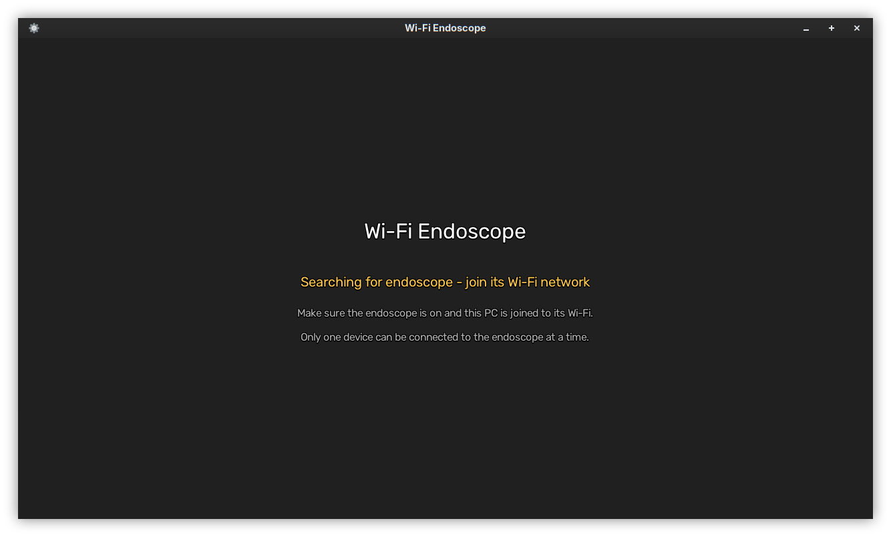
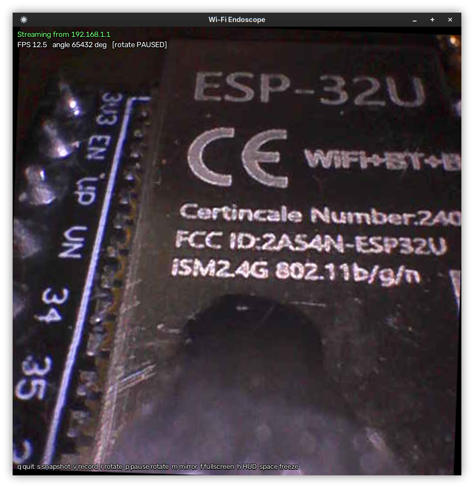
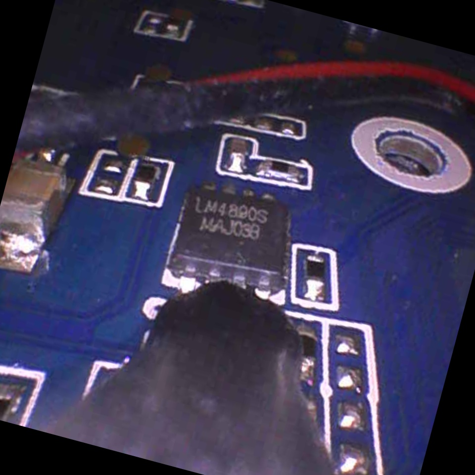
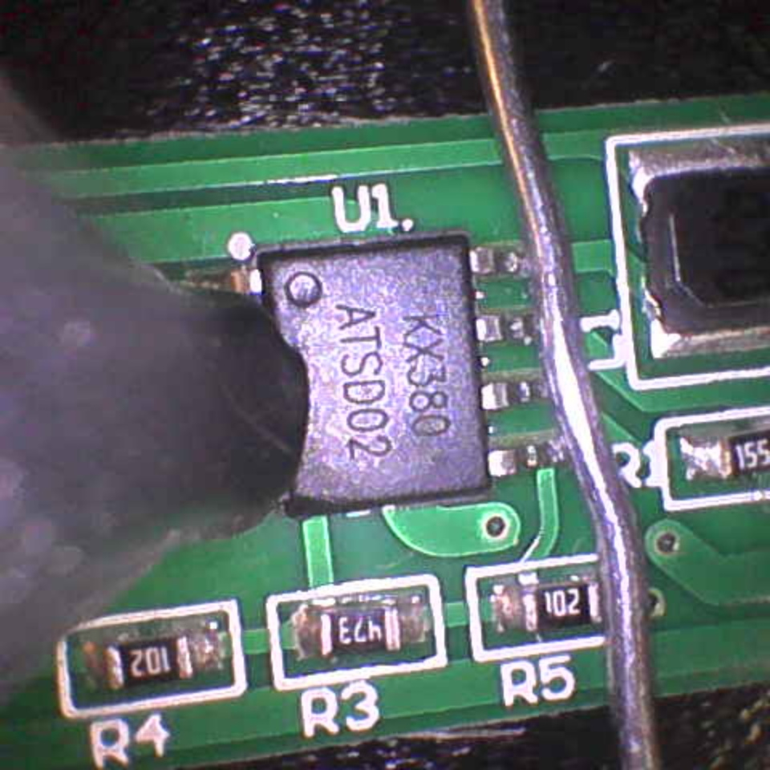

# ne3-viewer
mini endoscope viewer NE3/NE7 earpick wireless endoscope/otoscope
# NE3 Viewer — Wi-Fi endoscope viewer (NE3 / NE7 protocol)

[](LICENSE)
[](https://github.com/misjah/ne3viewer/releases/latest)
[](https://github.com/misjah/ne3viewer/releases/latest)
[](https://github.com/misjah/ne3viewer/releases/latest)

Single-file cheap aliexpress endoscope viewer built from [haxko/NE3-Scope](https://github.com/haxko/NE3-Scope)
(`client2.py` + `ne7.py`, WTFPL). No installation required — just run the prebuilt
binary on Windows or Linux.
Originally intended to be viewed by android app for ear cleaning but in my case useful for tiny prints and electronics.

> **Note:** This repo contains the compiled binaries. Source code is kept minimal;
> see "Building from source" if you want to rebuild it yourself.

---
<p align="center">
  
</p>
<p align="center">
  
</p>
<p align="center">
  
</p>
<p align="center">
  
</p>
---

## 📦 Download

Grab the latest binaries from the [**Releases** page](https://github.com/misjah/ne3viewer/releases/latest):

| Platform | File |
|----------|------|
| Windows | `ne3-viewer.exe` |
| Linux   | `ne3-viewer` (single executable) |

---

## 🚀 Quick start

### Windows

1. Switch the endoscope on and join its Wi-Fi network from the PC.
2. Run `ne3-viewer.exe` (double-click or from Command Prompt).
3. If Windows Firewall prompts, allow access on **Private** networks.

### Linux

```bash
chmod +x ne3-viewer
./ne3-viewer          # prebuilt binary — nothing to install
# or
python3 ne3_viewer.py # needs: pip install opencv-python numpy
```

The viewer finds the endoscope by itself (no fixed subnet), reconnects if the
Wi-Fi drops, and shows a status screen while searching.

---

## ⌨️ Controls

| Key | Action |
|-----|--------|
| q / Esc | Quit |
| s | Snapshot (JPG, `~/Pictures/Endoscope`) |
| v | Start / stop recording (MJPG `.avi`) |
| r | Auto-rotate (tilt sensor) on/off |
| p | Pause / resume rotation |
| m | Mirror image |
| f | Fullscreen |
| h | Hide / show on-screen info |
| Space | Freeze / unfreeze picture |

Pictures scale to fit the window with dark-gray bars (also maximized / fullscreen).

---

## 🔧 Options

```
--ip 192.168.1.1      Skip discovery, connect straight to this address
--broadcast ADDR      Also probe this broadcast address (repeatable)
--scale 1.5           Picture scale for window, snapshots, recordings (default 2.0)
--no-rotate           Start with auto-rotation off
--check [SECONDS]     No window: connect, count frames, report (troubleshooting)
-v                    Verbose (prints sensor values)
```

---

## 🛠 Troubleshooting

* **No video received** — network problem, not a display problem. Run `./ne3-viewer --check` first.
* Only one device can talk to the endoscope at a time — close the phone app.
* If your firewall blocks incoming UDP from the endoscope, allow **UDP port 36123**.
* Black window / Qt error on pure Wayland: run with `QT_QPA_PLATFORM=wayland` or use an X11 session.

---

## 📄 License

MIT. See [LICENSE](LICENSE) for details. The underlying NE3-Scope code is WTFPL.

---

## Credits

* [haxko/NE3-Scope](https://github.com/haxko/NE3-Scope) — original protocol reverse-engineering and Python viewer.
* Icons / splash art — *(add your own screenshot/GIF here to make the repo pop)*.


